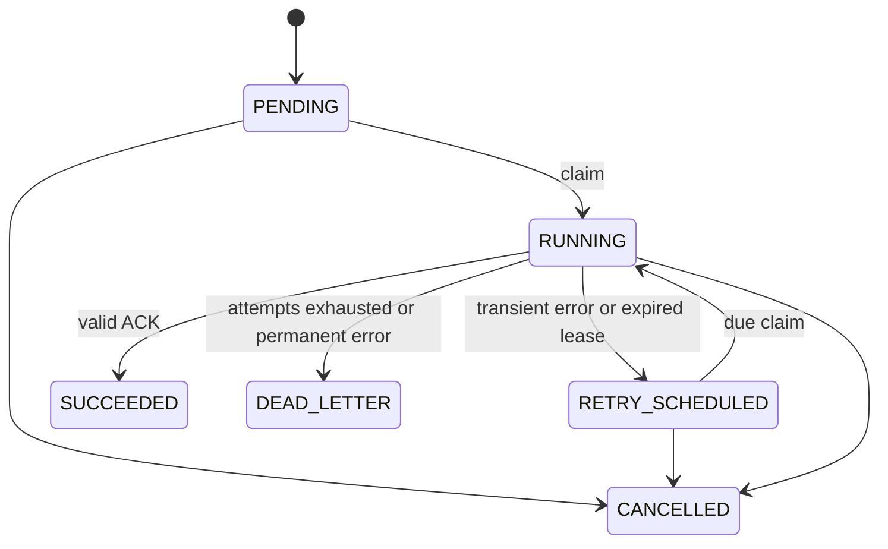

# Architecture and invariants

## Components and boundaries

`taskmesh api` accepts validated jobs and serves persisted results; it never executes
handlers. `taskmesh worker` owns a bounded pool of Tokio tasks and an explicit handler
registry. `taskmesh controller` scans expired leases in batches of 100 every five
seconds. PostgreSQL is the sole source of truth. These are separate OS processes
built from one binary, not separate infrastructure services.

The storage module exposes submit, claim, renew, finish, recover and cancel. Read
queries use SQLx; coordination statements are in `src/sql.rs`. A Claim carries job ID, payload, timeout and fencing
generation; Finish and Renew require both the worker session UUID and generation.
Handlers expose validation and asynchronous execution returning JSON or an error.
Execution futures are polled alongside lease renewal, a timeout and shutdown. Built-in handlers have no external side effects.

## Schema and state machine

`queues` records admission/concurrency policy; `workers` records sessions,
capabilities and liveness; `jobs` records durable input/output and the current lease;
`job_attempts` records each generation; `job_events` records transitions; and
`idempotency_keys` links a normalized request hash to a durable job.

CHECK constraints enforce attempt limits, the lease/active-state relationship and
terminal timestamps. A trigger rejects invalid state transitions and records every
status change inside the same transaction. Terminal jobs never become active again.
Replay is not implemented; a new explicit submission creates a new job instead.

## Claim and locking

1. Lock one enabled queue row with `FOR UPDATE SKIP LOCKED`.
2. Count RUNNING jobs under that queue lock and enforce its global limit.
3. Lock the worker session, validate queue membership, heartbeat and capabilities,
   and enforce the worker's global capacity across queues.
4. Select one due supported job using `FOR UPDATE SKIP LOCKED`, ordered by descending
   priority then earliest run_at and ID.
5. Change to RUNNING, increment attempt and lease generation, set DB-clock expiry,
   insert the attempt, and commit before executing code.

Queue rows serialize competing claim/count operations; worker rows serialize
capacity checks across different queues. All claims acquire queue before worker,
and never acquire another queue in that transaction. Finish/recovery need no queue
lock because they only reduce RUNNING counts. New submissions also lock their queue
while checking the backlog cap. This is simple and safe, but queue-row contention
and count queries will bound throughput. No claim of unlimited horizontal scaling.

## Lease and recovery

Lease is 30 seconds, renewal every 10 seconds, worker heartbeat every 5 seconds.
DB time is authoritative; renewals are capped by the attempt's database start time
plus job timeout. Heartbeat is a liveness hint, separate from ownership. Expired ACKs
and renewals fail even before the controller has scanned that job.

Finish conditionally updates only a RUNNING job owned by the supplied UUID and
generation with an unexpired lease. Attempt closure and event insertion commit
atomically. Any ACK failure leaves the lease to be reconciled; the worker does not
pretend the result was saved. Recovery uses the same row locking and moves expired
work into retry or DLQ, closing its previous attempt in the same statement.

Retries use DB-clock exponential backoff: min(60s, 2^attempt_count seconds), multiplied
by uniform jitter in [0.75, 1.25). Due retries are claimed directly; no separate
promotion loop is needed. Validation failures are permanent; runtime errors and
panics retry until the configured attempt limit. HTTP rejects invalid known inputs
before they enter the queue.

## Shutdown and cancellation

SIGTERM stops acquisition. Work and heartbeats drain for up to 30 seconds, then
execution futures are dropped. Compose allows 40 seconds before killing the container.
Crashes leave active leases for recovery. CPU-bound hashing yields to Tokio every 128 rounds. Dropping a future cannot
interrupt synchronous blocking code that never yields. Untrusted
code/process execution is absent. Cancel commits CANCELLED immediately and closes
the attempt; running code observes cancellation through lease renewal or timeout,
and cannot commit a subsequent result. This is best effort execution cancellation.

## References

The [PostgreSQL SELECT documentation](https://www.postgresql.org/docs/17/sql-select.html)
describes `SKIP LOCKED` for queue-like workloads. It does not promise FIFO fairness.
The [official PostgreSQL image](https://hub.docker.com/_/postgres) lists ARM64 support.
The Rust binary uses the Tokio runtime, Axum HTTP and SQLx PostgreSQL driver.
Docker builds for the target platform using the Rust Bookworm toolchain and runs
on Debian Bookworm slim. Native ARM64 tests run on the Raspberry Pi hardware.
